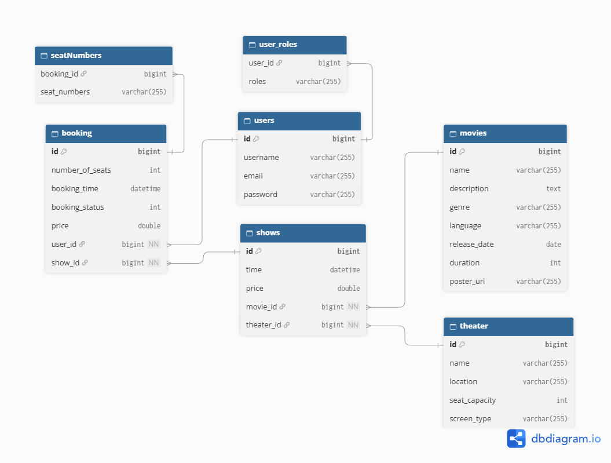

# BookMovies – Backend

A RESTful backend for a movie ticket booking application, built with **Java and Spring Boot**. It provides APIs for managing movies, theaters, shows, users, and bookings, with JWT-based authentication and role-based authorization.

**Live Application:** [https://bookmovies-web.vercel.app](https://bookmovies-web.vercel.app)  
**Frontend Repository:** [BookMovies-Frontend](https://github.com/bagadivenkatramesh/BookMovies-Frontend)

## Tech Stack

| Technology              | Purpose                                |
| ----------------------- | -------------------------------------- |
| Java 25                 | Backend programming language           |
| Spring Boot 4.1.1       | Application framework                  |
| Spring Web MVC          | REST API development                   |
| Spring Data JPA         | Database access and ORM                |
| Hibernate               | Object-relational mapping              |
| Spring Security         | Authentication and authorization       |
| JWT (JJWT 0.13.0)       | Token-based authentication             |
| MySQL 8                 | Relational database                    |
| Maven                   | Dependency and build management        |
| Lombok                  | Boilerplate code reduction             |
| Docker & Docker Compose | Containerization and local environment |
| Railway                 | Backend and database deployment        |
| Vercel                  | Frontend deployment                    |

## Features

- **User Authentication:** User registration and login.
- **JWT Authentication:** Stateless authentication using JSON Web Tokens.
- **Role-Based Authorization:** Separate access permissions for regular users and administrators.
- **Movie Management:** APIs for managing movie information.
- **Theater Management:** APIs for managing theater information.
- **Show Management:** APIs for managing movie shows and their scheduling.
- **Ticket Booking:** Booking functionality with seat selection and availability checks.
- **Input Validation:** Request validation using Jakarta Bean Validation.
- **Centralized Exception Handling:** Consistent API error responses through a global exception handler.

## Application Architecture

The backend follows a layered architecture:

```text
Client (React Frontend)
        |
        v
   REST Controllers
        |
        v
     Services
        |
        v
   Repositories
        |
        v
   MySQL Database
```

- **Controllers:** Handle incoming HTTP requests and return API responses.
- **Services:** Contain application and business logic.
- **Repositories:** Handle database operations using Spring Data JPA.
- **Entities:** Represent the application's database model.
- **DTOs:** Separate API request/response structures from persistence entities.

## Database Domain Model

The application uses the following primary entities:

| Entity  | Responsibility                           |
| ------- | ---------------------------------------- |
| User    | Stores user account and role information |
| Movie   | Stores movie details                     |
| Theater | Stores theater information               |
| Show    | Represents a scheduled movie show        |
| Booking | Stores ticket booking information        |

JPA and Hibernate handle object-relational mapping and database interactions.

### Entity Relationship Diagram



## Authentication and Authorization

The application uses **Spring Security with JWT-based authentication**.

1. A user registers through the registration API.
2. The user logs in using their credentials.
3. Spring Security authenticates the credentials.
4. A JWT is generated and returned after successful authentication.
5. The client includes the token in the `Authorization` header for protected API requests.
6. A JWT authentication filter validates incoming tokens and establishes the authenticated security context.

### Authorization

- Regular users are assigned the `ROLE_USER` role.
- Administrators are assigned the `ROLE_ADMIN` role.
- Administrative endpoints under `/api/admin/**` require administrator authorization.
- Passwords are stored using BCrypt hashing.
- The application uses stateless session management.

## API Documentation

All endpoints are prefixed with `/api`.

Request and response body types are represented by their corresponding DTO classes. Endpoints returning strings provide success messages, while delete endpoints return no response body.

### Authentication

| Method | Endpoint | Request Body | Response | Status | Access |
|---|---|---|---|---|---|
| POST | `/api/auth/register_normal_user` | `RegisterUserDTO` | `String` (success message) | 201 Created | Public |
| POST | `/api/auth/login` | `LoginUserDTO` | `LoginResponseDTO` | 200 OK | Public |
| GET | `/api/auth/me` | — | `UserResponseDTO` | 200 OK | Authenticated |

### Admin

All endpoints under `/api/admin/**` require `ROLE_ADMIN`.

| Method | Endpoint | Request Body | Response | Status | Access |
|---|---|---|---|---|---|
| POST | `/api/admin/register_admin_user` | `RegisterUserDTO` | `String` (success message) | 201 Created | ADMIN |

### Movies

| Method | Endpoint | Request Body / Parameters | Response | Status | Access |
|---|---|---|---|---|---|
| POST | `/api/movie/add_movie` | `MovieDTO` | `String` (success message) | 201 Created | ADMIN |
| GET | `/api/movie/get_all_movies` | — | `List<MovieResponseDTO>` | 200 OK | Authenticated |
| GET | `/api/movie/get_movies_by_genre` | `genre` (query parameter) | `List<MovieResponseDTO>` | 200 OK | Authenticated |
| GET | `/api/movie/get_movies_by_language` | `language` (query parameter) | `List<MovieResponseDTO>` | 200 OK | Authenticated |
| GET | `/api/movie/get_movie_by_title` | `title` (query parameter) | `MovieResponseDTO` | 200 OK | Authenticated |
| GET | `/api/movie/get_movie_by_id/{id}` | `id` (path variable) | `MovieResponseDTO` | 200 OK | Authenticated |
| PUT | `/api/movie/update_movie/{id}` | `id` (path variable), `MovieDTO` | `String` (success message) | 200 OK | ADMIN |
| DELETE | `/api/movie/delete_movie/{id}` | `id` (path variable) | No response body | 204 No Content | ADMIN |

### Theaters

| Method | Endpoint | Request Body / Parameters | Response | Status | Access |
|---|---|---|---|---|---|
| GET | `/api/theater/get_theaters_by_location` | `location` (query parameter) | `List<TheaterDTO>` | 200 OK | Authenticated |
| POST | `/api/theater/add_theater` | `TheaterDTO` | `String` (success message) | 201 Created | ADMIN |
| PUT | `/api/theater/update_theater/{id}` | `id` (path variable), `TheaterDTO` | `String` (success message) | 200 OK | ADMIN |
| DELETE | `/api/theater/delete_theater/{id}` | `id` (path variable) | No response body | 204 No Content | ADMIN |

### Shows

| Method | Endpoint | Request Body / Parameters | Response | Status | Access |
|---|---|---|---|---|---|
| POST | `/api/show/create_show` | `ShowDTO` | `ShowResponseDTO` | 201 Created | ADMIN |
| PUT | `/api/show/update_show/{id}` | `id` (path variable), `ShowDTO` | `String` (success message) | 200 OK | ADMIN |
| DELETE | `/api/show/delete_show/{id}` | `id` (path variable) | No response body | 204 No Content | ADMIN |
| GET | `/api/show/get_all_shows` | — | `List<ShowResponseDTO>` | 200 OK | Authenticated |
| GET | `/api/show/get_shows_by_movie/{movieId}` | `movieId` (path variable) | `List<ShowDetailsDTO>` | 200 OK | Authenticated |
| GET | `/api/show/get_shows_by_theater/{theaterId}` | `theaterId` (path variable) | `List<ShowDetailsDTO>` | 200 OK | Authenticated |

### Bookings

| Method | Endpoint | Request Body / Parameters | Response | Status | Access |
|---|---|---|---|---|---|
| POST | `/api/booking/create_booking` | `BookingDTO` | `String` (success message) | 201 Created | Authenticated |
| GET | `/api/booking/my_bookings` | — | `List<BookingResponseDTO>` | 200 OK | Authenticated |
| GET | `/api/booking/get_bookings_for_show/{show_id}` | `show_id` (path variable) | `List<BookingResponseDTO>` | 200 OK | Authenticated |
| PUT | `/api/booking/confirm_booking/{booking_id}` | `booking_id` (path variable) | `String` (success message) | 200 OK | Authenticated |
| PUT | `/api/booking/cancel_booking/{booking_id}` | `booking_id` (path variable) | `String` (success message) | 200 OK | Authenticated |
| GET | `/api/booking/get_bookings_by_status/{booking_status}` | `booking_status` (path variable) | `List<BookingResponseDTO>` | 200 OK | ADMIN |

Supported booking statuses:

- `PENDING`
- `CONFIRMED`
- `CANCELLED`

### Authentication and Authorization Details

- Login and normal user registration endpoints are publicly accessible.
- All other endpoints require authentication.
- Administrative operations require the `ROLE_ADMIN` authority.
- JWT must be included in the `Authorization` header when accessing protected endpoints:

```http
Authorization: Bearer <your-jwt-token>
```

### HTTP Response Status Codes

| Status Code | Description |
|---|---|
| `200 OK` | Request completed successfully. |
| `201 Created` | Resource created successfully. |
| `204 No Content` | Request completed successfully without a response body. |
| `400 Bad Request` | Invalid request data or validation failure. |
| `401 Unauthorized` | Authentication is missing or invalid. |
| `403 Forbidden` | Authenticated user does not have the required authority. |
| `404 Not Found` | Requested resource does not exist. |
| `409 Conflict` | Request conflicts with existing application data. |

## Local Setup Using Docker

Docker Compose starts the MySQL database and Spring Boot backend together.

### Prerequisites

- Git
- Docker Desktop

### 1. Clone the repository

```bash
git clone https://github.com/bagadivenkatramesh/BookMovies.git
cd BookMovies
```

### 2. Configure environment variables

Create two files in the project root.

**`.env.compose`**

```dotenv
MYSQL_ROOT_PASSWORD=your_mysql_root_password
MYSQL_DATABASE=bookmovies
```

**`.env.backend`**

```dotenv
DB_USERNAME=root
DB_PASSWORD=your_mysql_root_password
JWT_SECRET=your_secure_jwt_secret
JWT_EXPIRATION=3600000
```

Use a secure JWT secret appropriate for your environment. Do not commit either environment file to Git.

### 3. Start the application

```bash
docker compose up -d --build
```

This starts:

- MySQL on `localhost:3307`
- Spring Boot backend on `localhost:8080`

The backend connects to MySQL internally through the Docker Compose service name.

### 4. Verify the containers

```bash
docker compose ps
```

To view backend logs:

```bash
docker compose logs -f backend
```

The backend APIs are accessible at:

```text
http://localhost:8080
```

### 5. Stop the application

```bash
docker compose down
```

The named MySQL volume preserves database data between restarts. Avoid `docker compose down -v` unless you intentionally want to delete that volume and its data.

## Environment Configuration

The application reads database and JWT configuration from environment variables.

| Variable         | Description                             |
| ---------------- | --------------------------------------- |
| `DB_URL`         | JDBC connection URL                     |
| `DB_USERNAME`    | Database username                       |
| `DB_PASSWORD`    | Database password                       |
| `JWT_SECRET`     | Secret used for JWT signing             |
| `JWT_EXPIRATION` | JWT expiration duration in milliseconds |

For production deployment, the application uses the `prod` Spring profile. Production-specific configuration disables SQL logging and validates the existing database schema rather than automatically updating it.

## Deployment

The application is deployed using the following setup:

| Component           | Platform |
| ------------------- | -------- |
| React frontend      | Vercel   |
| Spring Boot backend | Railway  |
| MySQL database      | Railway  |

The backend is packaged as a Docker image and deployed on Railway. Database credentials and JWT configuration are supplied through Railway environment variables rather than committed to the repository.

**Live frontend:** [https://bookmovies-web.vercel.app](https://bookmovies-web.vercel.app)

## Related Repository

[BookMovies – Frontend](https://github.com/bagadivenkatramesh/BookMovies-Frontend)

---